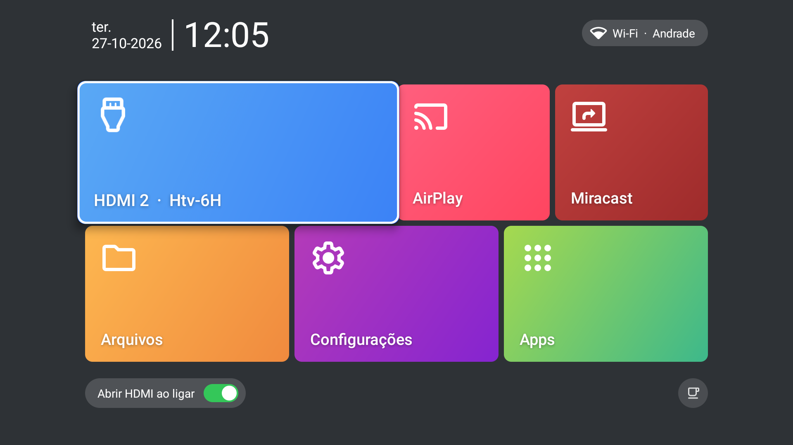

# Cineluz Launcher — launcher para projetor Android com HDMI em primeiro lugar

**Cineluz Launcher** é uma tela inicial (launcher) gratuita e de código aberto para
**projetores Android** e TV boxes, feita para quem usa o projetor principalmente pela
**entrada HDMI**. Ele mostra uma **prévia ao vivo e sem som do HDMI** na tela inicial,
pode **abrir direto no HDMI ao ligar**, não tem **nenhum anúncio** e não acessa a
internet. Foi criado e testado no **projetor HY320 (Magcubic, Allwinner H713,
Android 11)** e funciona em outros projetores e TV boxes com Android 7 ou mais novo.



> 🇬🇧 **English:** Cineluz Launcher is a free, open-source, ad-free **home screen for
> Android projectors** (tested on the **HY320 / Magcubic, Allwinner H713**) that puts the
> **HDMI input first**: live muted HDMI preview on the home screen, auto-open HDMI on
> boot, any HDMI port detected automatically. [Read in English ↓](#english)

## Por que usar

Muitos projetores Android baratos (HY300, HY320, L018 e parecidos) vêm com um launcher
de fábrica **cheio de anúncios**, com o HDMI escondido no meio de atalhos que você não
usa, e às vezes com um **descanso de tela que mostra propaganda em vídeo**. Launchers
alternativos de Android TV costumam **não mostrar a entrada HDMI** ou travar ao trocar
para ela. O Cineluz resolve exatamente isso:

- **Bloco HDMI ao vivo e mudo** — veja na tela inicial o que está passando no aparelho
  ligado ao HDMI (TV box, videogame, Fire TV, Chromecast…), sem som. OK abre em tela cheia.
- **Abrir o HDMI ao ligar** — liga o projetor e ele vai direto para a entrada HDMI
  (opcional, numa chave na própria tela inicial).
- **Qualquer porta HDMI** — as portas são detectadas sozinhas; ligue um aparelho em
  outra porta e a prévia muda para ela. Mostra até o nome do aparelho via **HDMI-CEC**.
- **O controle remoto do projetor continua comandando o aparelho no HDMI** (HDMI-CEC).
- **Sem anúncios, sem internet** — o app nem tem permissão de acesso à internet.
- **Descanso de tela com relógio** — substitui descansos de tela com propaganda.
- **Blocos configuráveis** — AirPlay (AirPin), Miracast, Arquivos e Configurações já
  vêm apontando para os apps certos do aparelho; qualquer bloco pode abrir outro app.
- **Indicador de Wi-Fi** — mostra a rede e o sinal; um clique abre a lista de redes.
- **Levíssimo** — cerca de 50 KB (o launcher de fábrica do HY320 tem ~21 MB).

## Compatibilidade

| Aparelho | Situação |
|---|---|
| **Projetor HY320** (Magcubic, Allwinner H713, Android 11) | ✅ Testado: HDMI ao vivo e mudo, abrir HDMI ao ligar, HDMI-CEC |
| **HY300, L018 e outros projetores Allwinner** | Deve funcionar igual (mesmo app de HDMI e mesmos ajustes de som) — [conte como foi](../../issues) |
| Outros projetores / TVs Android com entrada HDMI | HDMI abre na tela cheia do próprio Cineluz |
| TV box sem entrada HDMI (Mi Box, Fire TV, genéricas) | Funciona como launcher simples, sem o bloco HDMI ao vivo |

Requer **Android 7.0 ou mais novo**. Não precisa de root.

## Como instalar

1. No projetor, ative **Opções do desenvolvedor → Depuração USB** (em muitos
   projetores, também a **depuração pela rede / ADB**).
2. Baixe o APK mais recente em **[Releases](../../releases)**.
3. No computador, com o [adb (Android Platform Tools)](https://developer.android.com/tools/releases/platform-tools):

```bash
adb connect IP-DO-PROJETOR:5555
adb install cineluz-launcher-1.0.0.apk
adb shell cmd package set-home-activity com.elisson.cineluz/.HomeActivity
```

Opcional — mostrar o **nome da rede Wi-Fi** (o Android exige a permissão de localização
para isso) e usar o **relógio do Cineluz como descanso de tela**:

```bash
adb shell pm grant com.elisson.cineluz android.permission.ACCESS_FINE_LOCATION
adb shell settings put secure screensaver_components com.elisson.cineluz/com.elisson.cineluz.ClockDream
```

**Sem computador?** Copie o APK para um pendrive e instale pelo gerenciador de arquivos
do projetor. Se, ao apertar Home, o Android perguntar qual tela inicial usar, escolha
*Cineluz Launcher* e marque *Sempre*. (Se ele não perguntar, use o comando
`set-home-activity` acima pelo computador.)

### Voltar ao launcher original

```bash
adb uninstall com.elisson.cineluz
```

O Android volta sozinho para o launcher de fábrica.

## Como usar

| No controle | O que acontece |
|---|---|
| **OK** no bloco HDMI | Abre a entrada HDMI em tela cheia |
| **Segurar OK** (ou **Menu**) no bloco HDMI | Passa para a próxima porta HDMI |
| **Segurar OK** (ou **Menu**) em AirPlay, Miracast, Arquivos ou Configurações | Escolher o app daquele bloco |
| **Home** na tela inicial | Reinicia a prévia do HDMI (se a imagem sumir) |
| Chave **Abrir HDMI ao ligar** | Liga/desliga a abertura automática do HDMI |

## Perguntas frequentes

**Como tirar os anúncios do projetor HY320 (ou HY300)?**
Os anúncios vêm do launcher de fábrica e do descanso de tela dele. Instale o Cineluz
como tela inicial e troque o descanso de tela pelo relógio do Cineluz (comandos acima).
Não precisa trocar o firmware nem fazer root.

**Como fazer o projetor Android abrir direto no HDMI ao ligar?**
Com o Cineluz como tela inicial, deixe ligada a chave *Abrir HDMI ao ligar*. Na
primeira vez que a tela inicial aparece depois de ligar, ele abre a entrada HDMI
que tem sinal.

**Por que outros launchers (Projectivy, FLauncher) não mostram ou travam o HDMI?**
No HY320 e em outros projetores Allwinner, o HDMI é aberto por um app do fabricante
que precisa receber qual entrada abrir. Launchers genéricos abrem esse app sem essa
informação (ou nem o enxergam, porque ele não aparece como app comum). O Cineluz abre
do mesmo jeito que o launcher de fábrica e, em outros aparelhos, usa a entrada HDMI
direto pelo sistema de TV do Android.

**O controle do projetor continua funcionando no aparelho ligado ao HDMI?**
Sim. O repasse das teclas (HDMI-CEC) é feito pelo sistema do projetor, e o Cineluz
abre o HDMI da mesma forma que o launcher original.

**Por que a prévia do HDMI fica sem som?**
De propósito: a tela inicial fica silenciosa. Ao abrir o HDMI, o som volta normalmente.

**Funciona em TV box, Fire TV ou Android TV sem entrada HDMI?**
Funciona como um launcher simples e leve; só o bloco HDMI ao vivo não tem o que mostrar.

**Ele coleta dados ou precisa de internet?**
Não. O Cineluz não tem permissão de internet. As permissões usadas são: ajustes de
áudio (deixar a prévia muda), estado da rede/Wi-Fi (indicador de rede) e,
opcionalmente, localização (o Android só deixa ler o nome do Wi-Fi com ela).

**Preciso de root ou de firmware modificado?**
Não. É um app comum, instalado por adb ou pendrive, e dá para desinstalar a qualquer momento.

## Compilar

Sem Gradle — só o JDK 11+ e o Android SDK (`build-tools` 34+ e `platforms;android-30`):

```bash
./build.sh            # gera build/cineluz-launcher-<versão>.apk
./build.sh install    # gera e instala no aparelho conectado ao adb
```

Cada push no GitHub compila o APK automaticamente; cada tag `v*` publica uma versão
assinada em Releases. Contribuições e relatos de outros aparelhos são bem-vindos em
[Issues](../../issues).

## Apoie

O Cineluz é gratuito e vai continuar assim. Se ele foi útil e você quiser agradecer
com um cafezinho, qualquer valor via **PIX** ajuda a manter o projeto:


- **Chave PIX (e-mail):** `contato@elissonandrade.com.br`
- **PIX copia e cola:**
  ```
  00020126510014br.gov.bcb.pix0129contato@elissonandrade.com.br5204000053039865802BR5915ELISSON ANDRADE6007MARINGA62110507CINELUZ63041688
  ```

Obrigado! 🙏

---

## English

**Cineluz Launcher** is a free, open-source, lightweight (~50 KB) **Android launcher
for projectors** and TV boxes, built for people who mainly use their projector through
the **HDMI input**.

- **Live, muted HDMI preview** on the home screen; press OK to open HDMI full screen.
- **Auto-open HDMI on boot** (optional toggle on the home screen).
- **Any HDMI port** is detected automatically through Android's TV input framework;
  the preview follows the port where a device was just plugged in, and shows the device
  name via **HDMI-CEC**. The projector remote keeps controlling the HDMI device.
- **No ads, no internet permission**, plus an ad-free **clock screensaver** to replace
  manufacturer screensavers that show video ads.
- Configurable tiles (AirPlay, Miracast, Files, Settings), Wi-Fi indicator, app drawer.

**Tested on the HY320 projector (Magcubic, Allwinner H713, Android 11).** Other
Allwinner projectors (HY300, L018…) should behave the same; other devices with HDMI
inputs open HDMI in Cineluz's own full-screen player. Requires Android 7.0+, no root.

Install: download the APK from [Releases](../../releases), then
`adb install cineluz-launcher-1.0.0.apk` and
`adb shell cmd package set-home-activity com.elisson.cineluz/.HomeActivity`.
Uninstall with `adb uninstall com.elisson.cineluz` to go back to the stock launcher.

The app UI is currently in Brazilian Portuguese; translations are welcome.

## Licença / License

[Apache License 2.0](LICENSE). Ícones / icons:
[Material Symbols](https://github.com/google/material-design-icons) (Google, Apache 2.0).
