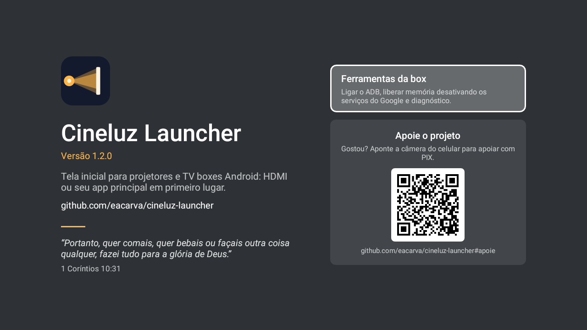
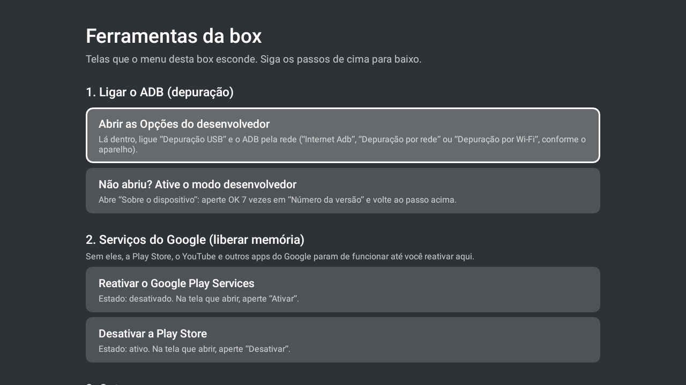

<p align="center">
  
</p>

# Cineluz Launcher — launcher leve e sem anúncios para projetor Android e TV box

**Cineluz Launcher** é uma tela inicial (launcher) **gratuita, com código aberto e sem
anúncios** para **projetores Android** e **TV boxes Android**. Em projetores, ele coloca a
**entrada HDMI em primeiro lugar**, com uma prévia ao vivo e sem som. Em TV boxes, o bloco
grande vira o seu **app principal**, que pode **abrir sozinho ao ligar**, inclusive quando a
box só sai do modo de espera. Tem cerca de **76 KB**, não acessa a internet e foi testado
no **projetor HY320** (Magcubic, Allwinner H713, Android 11) e na **TV box UniTV S1**
(Rockchip RK322x, Android 7.1.2).

**[⬇️ Baixar o Cineluz Launcher (APK)](https://github.com/eacarva/cineluz-launcher/releases/latest/download/cineluz-launcher.apk)**
— ou digite **`is.gd/cineluz`** no navegador da TV box ou do projetor.


> 🇬🇧 **English:** Cineluz Launcher is a free, source-available, ad-free, ~76 KB **home screen
> for Android projectors and Android TV boxes**. Tested on the **HY320 projector** and the
> **UniTV S1 TV box**. [Read in English ↓](#english)

## Em resumo

| | |
|---|---|
| **O que é** | Launcher (tela inicial) para projetor Android e TV box Android |
| **Preço** | Gratuito para uso pessoal, código aberto para ver e modificar, sem anúncios |
| **Licença** | [PolyForm Noncommercial 1.0.0](LICENSE): uso comercial só com autorização |
| **Tamanho** | ~76 KB |
| **Internet** | Não usa: o app não tem permissão de internet |
| **Android** | 7.0 ou mais novo, sem root |
| **Testado em** | Projetor **HY320** (Android 11) e TV box **UniTV S1** (Android 7.1.2) |
| **Instalar** | Baixar o APK em `is.gd/cineluz`, instalar e escolher como tela inicial |

## Por que usar

Projetores e TV boxes baratos costumam vir com um launcher de fábrica **pesado, lento e
cheio de anúncios**, às vezes com **propaganda em vídeo no descanso de tela**. Launchers
alternativos de Android TV costumam não mostrar a entrada HDMI ou não abrir nada sozinhos
quando a box liga. O Cineluz resolve isso:

- **Abre sozinho ao ligar** — o HDMI ou o app que você escolher, no botão **Ao ligar ⌄**
  da tela inicial. Funciona quando o aparelho reinicia **e quando a TV box só sai do modo
  de espera** pelo controle (caso da UniTV S1, que nem reinicia ao "desligar").
- **App principal em TV boxes** — sem entrada HDMI, o bloco grande vira o app que você
  mais usa. Na primeira vez, o Cineluz já pergunta qual é.
- **Bloco HDMI ao vivo e mudo** (projetores) — veja o que está passando no aparelho ligado
  ao HDMI sem sair da tela inicial. OK abre em tela cheia, e o controle do projetor
  continua comandando o aparelho pelo **HDMI-CEC**.
- **Qualquer porta HDMI** — detectada sozinha, com o nome do aparelho via HDMI-CEC.
- **Sem anúncios** — e um **relógio por inatividade** que aparece antes do descanso de tela
  do fabricante e muda de lugar para não marcar a imagem do projetor.
- **Blocos configuráveis** — AirPlay, Miracast, Arquivos e Configurações já apontam para os
  apps do aparelho; segure OK para escolher outro. Os ícones seguem o mesmo estilo, sem
  aqueles ícones coloridos e desencontrados dos apps.
- **Ferramentas da box** — em *Sobre*: abre as **Opções do desenvolvedor** escondidas
  (para ligar o **ADB**), desativa ou reativa os **serviços do Google** para liberar
  memória e mostra um **diagnóstico de energia**.
- **Indicador de Wi-Fi** — mostra a rede e o sinal; um clique abre a lista de redes.

## Mais leve e mais rápido que o launcher de fábrica

Medições feitas nos próprios aparelhos, pelo ADB:

| Aparelho | | Cineluz | Launcher de fábrica |
|---|---|---|---|
| **TV box UniTV S1** (1 GB de RAM) | Abrir a tela inicial | **0,7 s** | 2,5 s |
| | Memória do launcher | **8 a 13 MB** | 31 MB |
| | Processador parado | **0%** | ~2% |
| **Projetor HY320** (1 GB de RAM) | Memória do launcher | **~36 MB** (com a prévia HDMI) | ~87 MB |
| | Processador ao abrir | **~0%** | 70 a 184% (vídeos e anúncios) |
| | Tamanho do app | **~76 KB** | ~21 MB |

## Aparelhos testados

| Aparelho | Situação |
|---|---|
| **TV box UniTV S1** (Rockchip RK322x, Android 7.1.2) | ✅ App principal abrindo sozinho ao ligar e ao sair do modo de espera, blocos já configurados (App Market, Miracast, Explorer, Configurações de TV), ADB ligado pelas Ferramentas da box |
| **Projetor HY320** (Magcubic, Allwinner H713, Android 11) | ✅ HDMI ao vivo e mudo, HDMI abrindo sozinho ao ligar, HDMI-CEC, sem anúncios |
| **HY300, L018 e outros projetores Allwinner** | Deve funcionar igual ao HY320 — [conte como foi](../../issues) |
| **Outras TV boxes Rockchip / Amlogic** | Deve funcionar como na UniTV S1 — [conte como foi](../../issues) |
| Outros projetores e TVs Android com HDMI | HDMI abre na tela cheia do próprio Cineluz |
| Mi Box, Fire TV e TV boxes genéricas | Funciona como launcher com app principal |

## Como instalar

1. **Baixe o APK** — no navegador da TV box ou do projetor, digite **`is.gd/cineluz`**
   (ou use o app *Downloader*). Também dá para baixar no computador e passar por pendrive:

   **[⬇️ Baixar o Cineluz Launcher](https://github.com/eacarva/cineluz-launcher/releases/latest/download/cineluz-launcher.apk)**

2. **Instale** — abra o arquivo baixado. Se o Android pedir, permita instalar apps desse
   navegador ou gerenciador de arquivos (*fontes desconhecidas*).
3. **Abra o Cineluz.** Numa TV box, ele pergunta primeiro qual é o **app principal**.
   Depois, confirme o Cineluz como **tela inicial**, escolhendo **Sempre**.

O link `is.gd/cineluz` sempre leva à versão mais nova. Para atualizar, é só instalar por
cima: as suas escolhas continuam.

### Desinstalar

*Configurações → Apps → Cineluz Launcher → Desinstalar.* O aparelho volta sozinho para a
tela inicial de fábrica.

## Como usar

| No controle | O que acontece |
|---|---|
| **OK** no bloco grande | Abre o HDMI (projetor) ou o app principal (TV box) |
| **Segurar OK** (ou **Menu**) no bloco grande | Troca a porta HDMI (projetor) ou o app principal (TV box) |
| **Segurar OK** (ou **Menu**) em AirPlay, Miracast, Arquivos ou Configurações | Escolher o app daquele bloco |
| Botão **Ao ligar ⌄** (ex.: *HDMI ⌄*) | Escolher o que abrir ao ligar: HDMI ou um app |
| Chave verde/vermelha ao lado | Liga/desliga a abertura automática |
| Símbolo do Cineluz no canto inferior direito | **Sobre**: Ferramentas da box e como apoiar o projeto |
| **Home** na tela inicial | Volta o foco ao bloco grande e reinicia a prévia do HDMI |

Se ninguém mexer no controle por alguns minutos, aparece um **relógio** que muda de lugar
a cada minuto. Qualquer tecla volta.

<p align="center">
  
  
</p>

## Perguntas frequentes

### Qual o melhor launcher para a TV box UniTV S1?
O Cineluz foi testado na UniTV S1 e, medido na própria box, abre a tela inicial em 0,7 s
contra 2,5 s do launcher de fábrica, usando cerca de um quarto da memória. Ele já vem com
os blocos certos para ela (App Market, Miracast, Explorer e Configurações de TV) e abre o
app principal sozinho quando a box sai do modo de espera.

### Como trocar o launcher da TV box ou do projetor Android?
Instale o Cineluz pelo APK (`is.gd/cineluz`), abra e confirme quando ele perguntar se deve
ser a **tela inicial**, escolhendo **Sempre**. Para voltar ao de fábrica, desinstale o
Cineluz em *Configurações → Apps*.

### Como fazer a TV box abrir um app sozinho ao ligar?
Na tela inicial do Cineluz, aperte OK no botão **Ao ligar ⌄**, escolha o app e deixe a
chave verde. O app abre sozinho quando a box liga. Funciona também em boxes que não
desligam de verdade e só entram em modo de espera pelo controle, como a UniTV S1.

### Como fazer o projetor Android abrir direto no HDMI ao ligar?
Deixe **Ao ligar** em **HDMI** e a chave verde. Na primeira vez que a tela inicial aparece
depois de ligar, o Cineluz abre a entrada HDMI que tem sinal.

### Como tirar os anúncios do projetor HY320 (ou HY300)?
Os anúncios vêm do launcher de fábrica e do descanso de tela dele. Com o Cineluz como tela
inicial, a tela de fábrica sai de cena e, quando o projetor fica parado, aparece o relógio
do Cineluz no lugar da propaganda. Não precisa trocar o firmware, fazer root nem usar
computador.

### Como ativar o modo desenvolvedor e o ADB numa TV box travada (como a UniTV S1)?
Em algumas boxes, tocar 7 vezes em "Número da versão" não funciona pelo menu de fábrica.
No Cineluz, abra **Sobre → Ferramentas da box → Abrir as Opções do desenvolvedor**: ele
encontra a tela escondida e, lá dentro, você liga a *Depuração USB* e o ADB pela rede. Na
UniTV S1, a opção de rede se chama **"Internet Adb"**.

### Como liberar memória numa TV box com 1 GB de RAM?
Só o Google Play Services ocupa cerca de 180 MB numa box assim. Se você não usa a Play
Store nem apps do Google, em **Sobre → Ferramentas da box** o Cineluz guia como desativar
os serviços do Google — e como reativar depois, pelo mesmo botão.

### Por que outros launchers (Projectivy, FLauncher) não mostram ou travam o HDMI?
No HY320 e em outros projetores Allwinner, o HDMI é aberto por um app do fabricante que
precisa receber qual entrada abrir. Launchers genéricos abrem esse app sem essa
informação, ou nem o enxergam. O Cineluz abre do mesmo jeito que o launcher de fábrica e,
em outros aparelhos, usa a entrada HDMI direto pelo sistema de TV do Android.

### O controle do projetor continua funcionando no aparelho ligado ao HDMI?
Sim. O repasse das teclas (HDMI-CEC) é feito pelo sistema do projetor, e o Cineluz abre o
HDMI da mesma forma que o launcher original.

### Por que a TV também desliga quando desligo a TV box?
É o **HDMI-CEC** (na LG, *SimpLink*): ao entrar em modo de espera, a box avisa a TV, que
desliga junto, e ao ligar a box a TV liga junto. Não tem relação com o Cineluz e pode ser
desativado nas configurações da TV.

### Ele coleta dados ou precisa de internet?
Não. O Cineluz não tem permissão de internet. As permissões usadas são: ajustes de áudio
(deixar a prévia do HDMI muda), estado da rede e do Wi-Fi (indicador de rede) e,
opcionalmente, localização — o Android só deixa ler o nome do Wi-Fi com ela.

### Preciso de computador, root ou firmware modificado?
Não. É um app comum: baixe, instale e escolha como tela inicial. Dá para desinstalar a
qualquer momento.

## Para desenvolvedores

Compila sem Gradle — só o JDK 11+ e o Android SDK (`build-tools` 34+ e
`platforms;android-30`):

```bash
./build.sh            # gera build/cineluz-launcher-<versão>.apk
./build.sh install    # gera e instala no aparelho conectado ao adb
```

Cada push compila o APK no GitHub Actions; cada tag `v*` publica uma versão assinada em
Releases. Em aparelhos que deixam escolher o descanso de tela, o Cineluz também oferece o
*Relógio do Cineluz* como descanso de tela do sistema. Ajustes de fábrica por aparelho
ficam em `DeviceDefaults.java`. Relatos de outros aparelhos e contribuições são
bem-vindos em [Issues](../../issues).

As Ferramentas da box também existem como app separado, para boxes sem o Cineluz:
[Abrir Configurações](tools/abrir-configuracoes/).

## Apoie

O Cineluz é gratuito e vai continuar assim. Se ele foi útil e você quiser agradecer
com um cafezinho, qualquer valor via **PIX** ajuda a manter o projeto:


- **Chave PIX (e-mail):** `contato@elissonandrade.com.br`
- **PIX copia e cola:**
  ```
  00020126510014br.gov.bcb.pix0129contato@elissonandrade.com.br5204000053039865802BR5915ELISSON ANDRADE6007MARINGA62110507CINELUZ63041688
  ```

Obrigado! 🙏

---

## English

**Cineluz Launcher** is a free, source-available, ad-free, lightweight (~76 KB) **launcher
(home screen) for Android projectors and Android TV boxes**.

- **Opens your main app or HDMI automatically** when the device turns on — including TV
  boxes that only wake from standby with the remote (like the UniTV S1).
- **Main-app tile on TV boxes** without HDMI; asks for it on first launch.
- **Live, muted HDMI preview** on projectors; OK opens HDMI full screen, and the remote
  keeps controlling the HDMI device through **HDMI-CEC**. Any HDMI port is detected.
- **No ads, no internet permission.** An idle **clock** that moves every minute (no
  burn-in) shows up before manufacturer screensavers with video ads.
- **Box tools** (in *About*): open hidden **Developer options** to enable **ADB**,
  disable/re-enable **Google services** to free memory on 1 GB boxes, power diagnostics.
- Configurable tiles with matching icons, Wi-Fi indicator, app drawer.

**Tested on:** the **UniTV S1** TV box (Rockchip RK322x, Android 7.1.2) — home screen in
0.7 s vs 2.5 s for the stock launcher, about a quarter of the memory — and the **HY320
projector** (Magcubic, Allwinner H713, Android 11). Requires Android 7.0+, no root.

**Install:** type **`is.gd/cineluz`** in the device's browser (or
[download the APK](https://github.com/eacarva/cineluz-launcher/releases/latest/download/cineluz-launcher.apk)),
install it (allow unknown sources if asked), open Cineluz and set it as the home app
(*Always*). To go back, uninstall it from Settings → Apps.

The app UI is currently in Brazilian Portuguese; translations are welcome.

## Licença / License

**[PolyForm Noncommercial License 1.0.0](LICENSE).** Você pode usar, estudar, modificar e
compartilhar o Cineluz **de graça, para uso pessoal e não comercial**. **Uso comercial**
— vender, pré-instalar em aparelhos vendidos, cobrar por instalação ou por serviços com
ele, ou distribuir versões modificadas com fins comerciais — **só com autorização do
autor**: contato@elissonandrade.com.br.

*Free for personal and other noncommercial use. Commercial use (selling it, preinstalling
it on devices for sale, charging for it) requires permission from the author.*

Ícones / icons: [Material Symbols](https://github.com/google/material-design-icons)
(Google), sob a licença original deles, Apache 2.0 ([texto](licenses/Apache-2.0.txt)).
